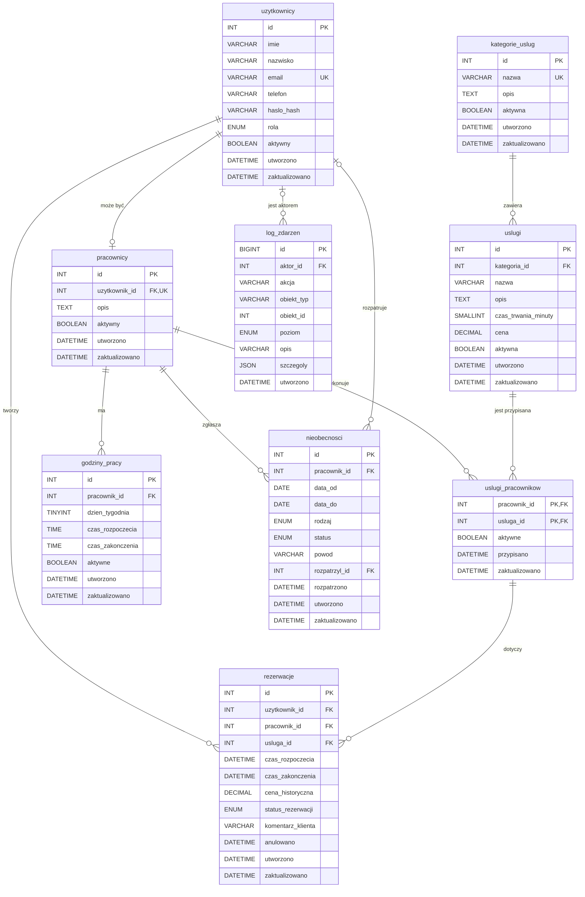

# WeFixIT

System rezerwacji dla serwisu komputerowego. Obsługuje klientów, pracowników i administratorów.

**Wersja online:** <https://wefixit.dziaslo.dev>

## Spis treści

- [Technologie](#Technologie)
- [Baza danych](#Baza-danych)
- [Zakres projektu](#zakres-projektu)
- [Wymagania](#wymagania)
- [Uruchomienie przez Docker](#uruchomienie-przez-docker)
- [Uruchomienie przez XAMPP](#uruchomienie-przez-xampp)
- [Testy integracyjne](#testy-integracyjne)
- [Autorzy](#Autorzy)

## Technologie
Projekt wykorzystuje następujące technologie:
- PHP 8.2 + Apache, PDO
- MariaDB 11.4
- HTML5, Tailwind CSS 4.3.3 standalone CLI, vanilla JS
- Docker Compose v2, kompatybilność XAMPP

## Baza danych
Wykorzystywana jest baza danych MariaDB. Pusta wersja znajduje się w pliku [database-czysta.sql](database/database-czysta.sql), a wersja z danymi testowymi w [database.sql](database/database.sql).

Poniżej znajduje się diagram wykorzystywanej bazy danych.




### Opis tabel nieobecnosci i log_zdarzen

- `nieobecnosci` przechowuje urlopy, choroby i inne nieobecności pracowników w zakresie dat. Status `oczekujaca` oznacza wniosek przed decyzją, a `zatwierdzona`, `odrzucona` lub `anulowana` — jego rozstrzygnięcie. Przy zatwierdzeniu lub odrzuceniu zapisywane są `rozpatrzyl_id` i `rozpatrzono`.
- `log_zdarzen` jest dziennikiem audytowym istotnych operacji. Zapisuje aktora, akcję, typ i identyfikator obiektu, poziom (`info`, `warning`, `critical`), opis oraz opcjonalne szczegóły w formacie JSON. Nie zastępuje danych biznesowych, tylko dokumentuje zmiany.

### Wersja pusta
Pusta edycja bazy danych jak sama nazwa wskazuje nie zawiera żadnych danych w sobie. Zalecane użycie w środowisku produkcyjnym.

### Wersja testowa
Testowa edycja bazy danych zawiera wszystko co wersja pusta plus dane testowe. Zalecana ona jest do użycia w celach testowych.

Daty rezerwacji w wersji testowej są liczone względem `CURDATE()` i dopasowane do grafiku pracowników. Rezerwacja na dziś powstaje tylko w dni robocze; w weekend odpowiednik statusu `w_trakcie` trafia na najbliższy poniedziałek.

#### Konta testowe

| Rola | Imię i nazwisko | E-mail | Hasło |
|------|-----------------|--------|-------|
| Administrator | Administrator Systemu | `admin@wefixit.pl` | `haslo123` |
| Pracownik | Tomasz Serwisant | `tomasz.serwisant@wefixit.pl` | `haslo123` |
| Pracownik | Marcin Elektronik | `marcin.elektronik@wefixit.pl` | `haslo123` |
| Pracownik | Kamil Testowy | `kamil.testowy@wefixit.pl` | `haslo123` |
| Klient | Jan Kowalski | `jan.kowalski@example.com` | `haslo123` |
| Klient | Anna Nowak | `anna.nowak@example.com` | `haslo123` |
| Klient | Piotr Wiśniewski | `piotr.wisniewski@example.com` | `haslo123` |

Wszystkie konta testowe mają identyczny `haslo_hash`, ponieważ korzystają ze wspólnego hasła testowego `haslo123`. To zamierzone ułatwienie środowiska testowego — hashy nie należy zmieniać pojedynczo ani używać tego hasła poza testami.

## Zakres projektu

WeFixIT to system rezerwacji dla serwisu komputerowego z trzema rolami: klient, pracownik, administrator.

### Zrealizowano w Etapie 1

- Schemat bazy MariaDB 11.4: 9 tabel (`uzytkownicy`, `pracownicy`, `kategorie_uslug`, `uslugi`, `uslugi_pracownikow`, `godziny_pracy`, `nieobecnosci`, `rezerwacje`, `log_zdarzen`).
- Relacje 1:N oraz relacja N:M pracownik–usługa przez `uslugi_pracownikow`.
- Integralność: klucze obce, `UNIQUE` na e-mail, `CHECK` na ceny / czasy / statusy, `ON DELETE RESTRICT`.
- Aktualny diagram ERD w Mermaid powyżej.
- Dane testowe: 1 administrator, 3 konta pracowników (w tym jedno bez profilu), 3 klientów, usługi, grafik i rezerwacje.
- Środowisko uruchomieniowe: Docker Compose dev + prod oraz instrukcja pod XAMPP.

### Zrealizowano w Etapie 2 - Użytkownicy i logowanie

- Rejestracja konta klienta z walidacją po stronie serwera i rolą ustawianą przez serwer.
- Logowanie i wylogowanie z obsługą sesji PHP, ochroną CSRF i odświeżaniem identyfikatora sesji.
- Podział na role: klient, pracownik, administrator.
- Ochrona stron i endpointów przed dostępem bez sesji lub bez wymaganej roli.
- Profil użytkownika: podgląd i edycja imienia, nazwiska, e-maila i telefonu.
- Ciemny motyw zależny od preferencji systemu, wspólny layout oraz powiadomienia toast.

#### Role i dostęp

| Rola | Dostęp |
|------|--------|
| Klient (`klient`) | `/panel`, `/profil`, `GET /api/me`, `PATCH /api/profile` |
| Pracownik (`pracownik`) | jak klient oraz `/pracownik` |
| Administrator (`admin`) | jak pracownik oraz `/admin` |

Konto klienta powstaje wyłącznie przez rejestrację. Rolę zawsze ustala serwer,
więc pola `rola` i `aktywny` przesłane w formularzu są ignorowane. Strona
`/register` tworzy konto z rolą `klient`, a `/pracownik` i `/admin` wymagają
odpowiednio roli pracownika i administratora.

Panel `/pracownicy` nie tworzy nowych kont użytkowników. Tworzy wyłącznie
profil pracownika powiązany z istniejącym, aktywnym kontem o roli `pracownik`.
Rejestracja kont ma własną ścieżkę, a nadanie roli pracownika wymaga świadomej
decyzji administratora.

#### Endpointy JSON

| Metoda i adres | CSRF | Najważniejsze kody odpowiedzi |
|----------------|------|-------------------------------|
| `POST /api/auth/register` | tak | 201 sukces, 409 zajęty e-mail, 422 błędy walidacji, 415 zły `Content-Type` |
| `POST /api/auth/login` | tak | 200 sukces z rolą, 401 błędne dane logowania, 422 błędy walidacji, 415 zły `Content-Type` |
| `POST /api/auth/logout` | tak | 200 sukces, 403 brak CSRF, 405 zła metoda |
| `GET /api/me` | nie | 200 dane zalogowanego użytkownika, 401 brak sesji |
| `PATCH /api/profile` | tak | 200 sukces, 401 brak sesji, 403 brak CSRF, 409 zajęty e-mail, 422 błędy walidacji |

Token CSRF przesyłany jest w nagłówku `X-CSRF-Token`. Body żądań i odpowiedzi
są w formacie JSON (`Content-Type: application/json`). `GET /api/me` nigdy nie
zwraca `haslo_hash` ani `aktywny`.

#### Sesja i CSRF

Sesja korzysta z cookie `PHPSESSID` ustawionego jako `HttpOnly` i `SameSite=Lax`;
flaga `Secure` jest dodawana, gdy aplikacja działa po HTTPS. Po zalogowaniu
identyfikator sesji jest odświeżany (`session_regenerate_id`), a token CSRF
rotowany. Operacje zmieniające stan wymagają nagłówka `X-CSRF-Token` zgodnego
z tokenem zapisanym w sesji. Formularze korzystają z `fetch()` i wymagają
włączonego JavaScriptu.

## Wymagania

Do uruchomienia aplikacji należy wybrać jedną z poniższych metod:

- Docker z obsługą Compose,
- XAMPP z Apache, PHP i MySQL.

### Konfiguracja środowiska

Plik `.env` jest jedynym źródłem konfiguracji aplikacji, w szczególności
połączenia z bazą danych. Należy utworzyć go na podstawie `.env.example` i
dostosować do wybranego środowiska. Plik `.env` znajduje się w katalogu
głównym projektu, poza katalogiem `public/`, i jest ignorowany przez Git — nie
trafia do repozytorium.

## Uruchomienie przez Docker

Docker uruchamia aplikację razem z serwerem MariaDB oraz automatycznie ładuje testową bazę danych.

1. Sklonuj repozytorium i przejdź do jego katalogu:

   ```bash
   git clone https://github.com/Mord0reK/WeFixIT.git
   cd WeFixIT
   ```

2. Utwórz plik `.env` na podstawie `.env.example` i w razie potrzeby zmień hasła:

   ```bash
   cp .env.example .env
   ```

3. Zbuduj obrazy i uruchom kontenery:

   ```bash
   docker compose --env-file .env -f docker/docker-compose.dev.yml up --build
   ```

   Polecenie wykonuj z katalogu głównego projektu, ponieważ właśnie stamtąd
   Compose wczytuje plik `.env`. 

4. Otwórz aplikację w przeglądarce: [http://localhost:8080](http://localhost:8080).

Aby zatrzymać aplikację, użyj `Ctrl+C` albo uruchom:

```bash
docker compose --env-file .env -f docker/docker-compose.dev.yml down
```

Baza danych jest przechowywana w wolumenie Dockera. Aby rozpocząć od nowej bazy i ponownie załadować dane testowe, usuń także wolumen:

```bash
docker compose --env-file .env -f docker/docker-compose.dev.yml down -v
docker compose --env-file .env -f docker/docker-compose.dev.yml up --build
```

## Uruchomienie przez XAMPP

Uruchomienie przez XAMPP:

1. Zainstalować XAMPP i uruchomić moduły **Apache** oraz **MySQL**.
2. Rozpakować projekt do `C:\xampp\htdocs\WeFixIT` (Windows) albo odpowiednika katalogu `htdocs` na danym systemie.
3. Otworzyć [phpMyAdmin](http://localhost/phpmyadmin), utworzyć bazę `wefixit` i zaimportować plik [database.sql](database/database.sql). Na potrzeby produkcyjne można użyć [database-czysta.sql](database/database-czysta.sql).
4. Utworzyć plik `.env` w katalogu głównym projektu na podstawie `.env.example` i ustawić dane XAMPP. Dla standardowej instalacji użyj:

   ```dotenv
   DB_HOST=localhost
   DB_PORT=3306
   DB_NAME=wefixit
   DB_USER=root
   DB_PASSWORD=
   ```

   Jeśli konto MySQL `root` ma ustawione hasło, wpisz je w `DB_PASSWORD`. Nie należy edytować plików PHP — konfigurację zmienia się wyłącznie w `.env`.

5. Otworzyć aplikację pod adresem [http://localhost/WeFixIT/public/](http://localhost/WeFixIT/public/). Alternatywnie można skonfigurować VirtualHost z `DocumentRoot` wskazującym na katalog `public/` i używać adresu ustawionego dla tego VirtualHosta.

W środowisku Docker wartość `DB_HOST` musi wynosić `mariadb`; w środowisku XAMPP — `localhost`.

## Testy integracyjne

Testy Etapu 2 znajdują się w katalogu [`tests/`](tests/) i sprawdzają aplikację
przez HTTP na izolowanej bazie testowej (domyślnie `wefixit_test`). Nie korzystają
z bazy deweloperskiej ani z wolumenu Dockera.

### Wymagania

- PHP 8.2 z rozszerzeniami `curl`, `mbstring`, `pdo_mysql` i `session`.
- Działający serwer MariaDB 11.4 lub MySQL.

### Konfiguracja

Testy czytają połączenie ze zmiennych środowiskowych:

```dotenv
DB_HOST=127.0.0.1
DB_PORT=3306
DB_NAME=wefixit_test
DB_USER=root
DB_PASSWORD=twoje-haslo
```

Baza o nazwie z `DB_NAME` jest importowana od zera z
[database.sql](database/database.sql) lub
[database-czysta.sql](database/database-czysta.sql) przed każdą grupą testów,
więc każde uruchomienie startuje z czystego stanu.

### Uruchomienie

Z katalogu głównego projektu:

```bash
DB_HOST=127.0.0.1 DB_PORT=3306 DB_NAME=wefixit_test DB_USER=root DB_PASSWORD=haslo \
  php tests/run.php
```

Testy same uruchamiają wbudowany serwer PHP (`php -S`) na czas trwania zestawu
i uderzają w ścieżki z rozszerzeniem `.php`, ponieważ `php -S` nie obsługuje
`.htaccess`. Po zakończeniu wypisują liczbę testów poprawnych i niepoprawnych
oraz sprawdzają, czy log serwera nie zawiera błędów PHP.

Tymczasowy serwer MariaDB do testów można uruchomić w Dockerze:

```bash
docker run --rm -d --name wefixit-test-db \
  -e MARIADB_ROOT_PASSWORD=test-root -e MARIADB_DATABASE=wefixit_test \
  -p 127.0.0.1:13306:3306 mariadb:11.4

DB_HOST=127.0.0.1 DB_PORT=13306 DB_NAME=wefixit_test DB_USER=root DB_PASSWORD=test-root \
  php tests/run.php
```

Analogiczne testy uruchamia CI w zadaniu `http_tests`
([.github/workflows/check.yml](.github/workflows/check.yml)) na MariaDB 11.4.

## Autorzy

> - [JanDziaslo](https://github.com/JanDziaslo) (Bartosz N.)
>
> - [Mord0reK](https://github.com/Mord0reK) (Marcel S.)
