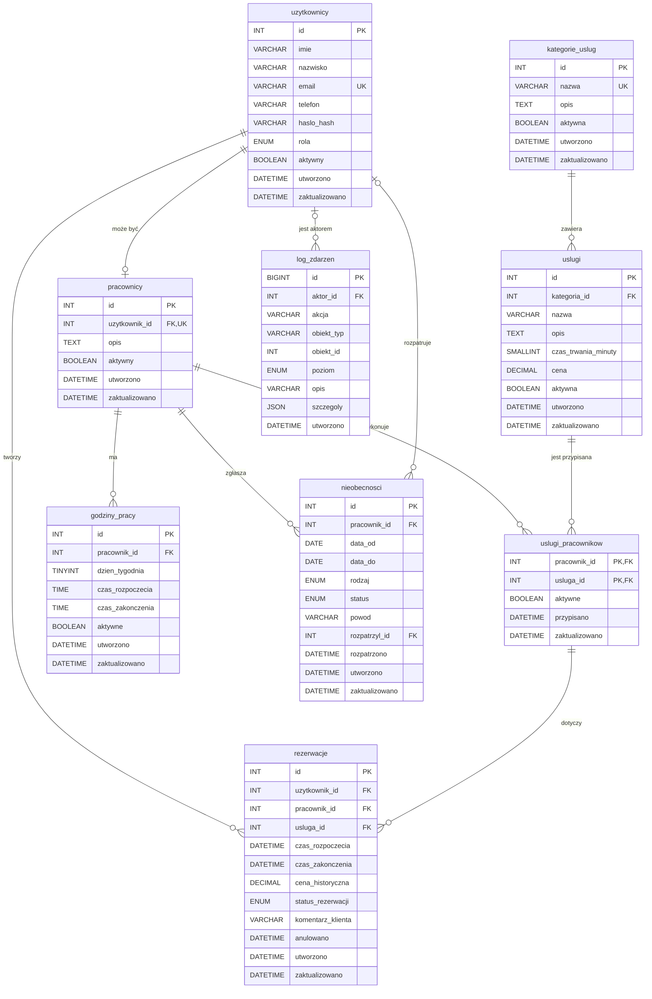

# WeFixIT

System rezerwacji dla serwisu komputerowego. Obsługuje klientów, pracowników i administratorów.

**Wersja online:** <https://wefixit.dziaslo.dev>

## Spis treści

- [Technologie](#technologie)
- [Baza danych](#baza-danych)
  - [Opis tabel nieobecnosci i log_zdarzen](#opis-tabel-nieobecnosci-i-log_zdarzen)
- [Zakres projektu](#zakres-projektu)
  - [Zrealizowano w Etapie 1](#zrealizowano-w-etapie-1)
  - [Zrealizowano w Etapie 2 - Użytkownicy i logowanie](#zrealizowano-w-etapie-2---użytkownicy-i-logowanie)
  - [Zrealizowano w Etapie 3 — panel administratora](#zrealizowano-w-etapie-3--panel-administratora)
- [Wymagania](#wymagania)
- [Uruchomienie przez Docker](#uruchomienie-przez-docker)
- [Uruchomienie przez XAMPP](#uruchomienie-przez-xampp)
- [Testy integracyjne](#testy-integracyjne)
- [Autorzy](#autorzy)

## Technologie
Projekt wykorzystuje następujące technologie:
- PHP 8.2 + Apache, PDO
- MariaDB 11.4
- HTML5, Tailwind CSS 4.3.3 standalone CLI, vanilla JS
- Docker Compose v2, kompatybilność XAMPP

## Baza danych
Wykorzystywana jest baza danych MariaDB. Pusta wersja znajduje się w pliku [database-czysta.sql](database/database-czysta.sql), a wersja z danymi testowymi w [database.sql](database/database.sql).

Poniżej znajduje się diagram wykorzystywanej bazy danych.




### Opis tabel nieobecnosci i log_zdarzen

- `nieobecnosci` przechowuje urlopy, choroby i inne nieobecności pracowników w zakresie dat. Status `oczekujaca` oznacza wniosek przed decyzją, a `zatwierdzona`, `odrzucona` lub `anulowana` — jego rozstrzygnięcie. Przy zatwierdzeniu lub odrzuceniu zapisywane są `rozpatrzyl_id` i `rozpatrzono`.
- `log_zdarzen` jest dziennikiem audytowym istotnych operacji. Zapisuje aktora, akcję, typ i identyfikator obiektu, poziom (`info`, `warning`, `critical`), opis oraz opcjonalne szczegóły w formacie JSON. Nie zastępuje danych biznesowych, tylko dokumentuje zmiany.

### Wersja pusta
Pusta edycja bazy danych jak sama nazwa wskazuje nie zawiera żadnych danych w sobie. Zalecane użycie w środowisku produkcyjnym.

### Wersja testowa
Testowa edycja bazy danych zawiera wszystko co wersja pusta plus dane testowe. Zalecana ona jest do użycia w celach testowych.

Daty rezerwacji w wersji testowej są liczone względem `CURDATE()` i dopasowane do grafiku pracowników. Rezerwacja na dziś powstaje tylko w dni robocze; w weekend odpowiednik statusu `w_trakcie` trafia na najbliższy poniedziałek.

#### Konta testowe

| Rola | Imię i nazwisko | E-mail | Hasło |
|------|-----------------|--------|-------|
| Administrator | Administrator Systemu | `admin@wefixit.pl` | `haslo123` |
| Pracownik | Tomasz Serwisant | `tomasz.serwisant@wefixit.pl` | `haslo123` |
| Pracownik | Marcin Elektronik | `marcin.elektronik@wefixit.pl` | `haslo123` |
| Pracownik | Kamil Testowy | `kamil.testowy@wefixit.pl` | `haslo123` |
| Klient | Jan Kowalski | `jan.kowalski@example.com` | `haslo123` |
| Klient | Anna Nowak | `anna.nowak@example.com` | `haslo123` |
| Klient | Piotr Wiśniewski | `piotr.wisniewski@example.com` | `haslo123` |

Wszystkie konta testowe mają identyczny `haslo_hash`, ponieważ korzystają ze wspólnego hasła testowego `haslo123`. To zamierzone ułatwienie środowiska testowego — hashy nie należy zmieniać pojedynczo ani używać tego hasła poza testami.

## Zakres projektu

WeFixIT to system rezerwacji dla serwisu komputerowego z trzema rolami: klient, pracownik, administrator.

### Zrealizowano w Etapie 1

- Schemat bazy MariaDB 11.4: 9 tabel (`uzytkownicy`, `pracownicy`, `kategorie_uslug`, `uslugi`, `uslugi_pracownikow`, `godziny_pracy`, `nieobecnosci`, `rezerwacje`, `log_zdarzen`).
- Relacje 1:N oraz relacja N:M pracownik–usługa przez `uslugi_pracownikow`.
- Integralność: klucze obce, `UNIQUE` na e-mail, `CHECK` na ceny / czasy / statusy, `ON DELETE RESTRICT`.
- Aktualny diagram ERD w Mermaid powyżej.
- Dane testowe: 1 administrator, 3 konta pracowników (w tym jedno bez profilu), 3 klientów, usługi, grafik i rezerwacje.
- Środowisko uruchomieniowe: Docker Compose dev + prod oraz instrukcja pod XAMPP.

### Zrealizowano w Etapie 2 - Użytkownicy i logowanie

- Rejestracja konta klienta z walidacją po stronie serwera i rolą ustawianą przez serwer.
- Logowanie i wylogowanie z obsługą sesji PHP, ochroną CSRF i odświeżaniem identyfikatora sesji.
- Podział na role: klient, pracownik, administrator.
- Ochrona stron i endpointów przed dostępem bez sesji lub bez wymaganej roli.
- Profil użytkownika: podgląd i edycja imienia, nazwiska, e-maila i telefonu.
- Ciemny motyw zależny od preferencji systemu, wspólny layout oraz powiadomienia toast.

#### Role i dostęp

| Rola | Dostęp |
|------|--------|
| Klient (`klient`) | `/panel`, `/profil`, `GET /api/me`, `PATCH /api/profile` |
| Pracownik (`pracownik`) | jak klient oraz `/pracownik` |
| Administrator (`admin`) | jak pracownik oraz `/admin`, `/kategorie`, `/uslugi`, `/pracownicy`, `/pracownicy-uslugi?id=…`, `/pracownicy-dostepnosc?id=…`, `/uzytkownicy`, `/rezerwacje`, `/log`, `/eksport?typ=rezerwacje` i `/eksport?typ=uzytkownicy` |

Rola jest sprawdzana po stronie serwera na każdej chronionej stronie przez
`require_role()` i na każdym chronionym endpointcie przez `require_api_login()`
oraz porównanie pola `rola`. Widoczność pozycji w menu (`panel_menu_items()`)
jest tylko wygodą interfejsu. Klient i pracownik, którzy ręcznie wpiszą adres
`/admin`, `/kategorie`, `/uzytkownicy` lub innej strony administracyjnej,
otrzymają odpowiedź 403. Bez sesji strona przekierowuje na `/login`, a endpoint
API zwraca 401. `auth_base_path()` sprawia, że linki i przekierowania działają
także w podkatalogu XAMPP.

Konto klienta powstaje wyłącznie przez rejestrację. Rolę zawsze ustala serwer,
więc pola `rola` i `aktywny` przesłane w formularzu są ignorowane. Strona
`/register` tworzy konto z rolą `klient`, a `/pracownik` i `/admin` wymagają
odpowiednio roli pracownika i administratora.

Panel `/pracownicy` nie tworzy nowych kont użytkowników. Tworzy wyłącznie
profil pracownika powiązany z istniejącym, aktywnym kontem o roli `pracownik`.
Rejestracja kont ma własną ścieżkę, a nadanie roli pracownika wymaga świadomej
decyzji administratora.

#### Endpointy JSON

| Metoda i adres | CSRF | Najważniejsze kody odpowiedzi |
|----------------|------|-------------------------------|
| `POST /api/auth/register` | tak | 201 sukces, 409 zajęty e-mail, 422 błędy walidacji, 415 zły `Content-Type` |
| `POST /api/auth/login` | tak | 200 sukces z rolą, 401 błędne dane logowania, 422 błędy walidacji, 415 zły `Content-Type` |
| `POST /api/auth/logout` | tak | 200 sukces, 403 brak CSRF, 405 zła metoda |
| `GET /api/me` | nie | 200 dane zalogowanego użytkownika, 401 brak sesji |
| `PATCH /api/profile` | tak | 200 sukces, 401 brak sesji, 403 brak CSRF, 409 zajęty e-mail, 422 błędy walidacji |
| `POST /api/admin/categories` | tak | 201 sukces, 409 nazwa zajęta, 422 walidacja |
| `PATCH /api/admin/categories` | tak | 200 sukces, 404 brak kategorii, 409 nazwa zajęta, 422 walidacja lub brak pól |
| `DELETE /api/admin/categories` | tak | 200 sukces, 400 zły JSON, 404 brak kategorii, 409 kategoria ma usługi, 422 zły `id` |
| `POST /api/admin/services` | tak | 201 sukces, 409 nazwa zajęta w kategorii, 422 walidacja |
| `PATCH /api/admin/services` | tak | 200 sukces, 404 brak usługi, 409 nazwa zajęta, 422 walidacja lub brak pól |
| `DELETE /api/admin/services` | tak | 200 sukces, 400 zły JSON, 404 brak usługi, 409 usługa ma przypisania lub rezerwacje, 422 zły `id` |
| `POST /api/admin/employees` | tak | 201 sukces, 409 konto ma już profil, 422 walidacja konta lub opisu |
| `PATCH /api/admin/employees` | tak | 200 sukces, 404 brak profilu, 422 walidacja lub próba zmiany konta |
| `DELETE /api/admin/employees` | tak | 200 sukces, 400 zły JSON, 404 brak profilu, 409 profil ma zależności, 422 zły `id` |
| `POST /api/admin/employee-services` | tak | 200 sukces, 404 brak pracownika, 422 niepoprawna lista lub usługa nieaktywna |
| `POST /api/admin/employee-schedule` | tak | 201 sukces, 404 brak pracownika, 422 walidacja, nakładanie lub duplikat |
| `PATCH /api/admin/employee-schedule` | tak | 200 sukces, 404 brak wpisu lub niezgodny pracownik, 422 walidacja lub kolizja |
| `DELETE /api/admin/employee-schedule` | tak | 200 sukces, 400 zły JSON, 404 brak wpisu lub niezgodny pracownik, 422 walidacja |
| `POST /api/admin/employee-absences` | tak | 201 sukces, 404 brak pracownika, 422 walidacja lub nakładanie |
| `PATCH /api/admin/employee-absences` | tak | 200 sukces (opcjonalne ostrzeżenie o rezerwacjach), 404 brak wniosku, 422 niedozwolone przejście |
| `PATCH /api/admin/users` | tak | 200 sukces, 404 brak konta, 422 walidacja, reguła ostatniego administratora lub własne konto |
| `GET /api/admin/reservations` | nie | 200 lista z metadanymi paginacji, 401 brak sesji, 403 brak roli |
| `PATCH /api/admin/reservations` | tak | 200 sukces, 404 brak rezerwacji, 422 walidacja lub niedozwolone przejście |

Endpointy administracyjne mogą dodatkowo zwrócić 400 (uszkodzony JSON),
401 (brak sesji), 403 (rola inna niż `admin` albo błędny CSRF), 405 (zła
metoda z nagłówkiem `Allow`), 415 (zły `Content-Type` dla POST/PATCH) i 500
(błąd serwera bez szczegółów technicznych). Publiczne adresy nie mają
rozszerzenia `.php`; Apache mapuje je na pliki w `public/` zgodnie z
[`public/.htaccess`](public/.htaccess).

Token CSRF przesyłany jest w nagłówku `X-CSRF-Token`. Body żądań i odpowiedzi
są w formacie JSON (`Content-Type: application/json`). `GET /api/me` nigdy nie
zwraca `haslo_hash` ani `aktywny`.

#### Sesja i CSRF

Sesja korzysta z cookie `PHPSESSID` ustawionego jako `HttpOnly` i `SameSite=Lax`;
flaga `Secure` jest dodawana, gdy aplikacja działa po HTTPS. Po zalogowaniu
identyfikator sesji jest odświeżany (`session_regenerate_id`), a token CSRF
rotowany. Operacje zmieniające stan wymagają nagłówka `X-CSRF-Token` zgodnego
z tokenem zapisanym w sesji. Formularze korzystają z `fetch()` i wymagają
włączonego JavaScriptu.

### Zrealizowano w Etapie 3 — panel administratora

Panel administratora jest dostępny wyłącznie dla roli `admin`. Publiczne
adresy nie mają rozszerzenia `.php`; Apache mapuje je na pliki w `public/`
zgodnie z regułą z [`public/.htaccess`](public/.htaccess). Każda strona
wywołuje `require_role(['admin'])`, a każdy endpoint sprawdza sesję i rolę po
stronie serwera.

| Moduł i ścieżka publiczna | Rola | Zakres |
|---------------------------|------|--------|
| Dashboard — `/admin` | `admin` | Pokazuje liczbę klientów, aktywnych pracowników, usług (w tym aktywnych), rezerwacji łącznie i rezerwacji na dziś. Tylko odczyt; nie zarządza danymi. |
| Kategorie — `/kategorie` | `admin` | Lista z wyszukiwaniem i paginacją, dodawanie i edycja, aktywacja/dezaktywacja oraz usuwanie kategorii bez usług. Nie przypisuje usług do kategorii; kategoria z usługami nie zostanie usunięta (409). |
| Usługi — `/uslugi` | `admin` | Lista z filtrami kategorii i statusu, wyszukiwaniem i paginacją; dodawanie i edycja nazwy, opisu, kategorii, ceny i czasu trwania, a także aktywacja/dezaktywacja. Nie przypisuje pracowników; usługa z przypisaniem lub rezerwacją nie zostanie usunięta (409). |
| Pracownicy — `/pracownicy` | `admin` | Lista, wyszukiwanie i paginacja; tworzenie profilu tylko dla istniejącego, aktywnego konta o roli `pracownik`, które nie ma jeszcze profilu; edycja opisu i aktywności oraz usuwanie profilu bez zależności. Nie tworzy ani nie usuwa kont użytkowników i nie zmienia ich ról. |
| Usługi pracownika — `/pracownicy-uslugi?id=N` | `admin` | Ustawia cały zbiór przypisań usług do wskazanego pracownika. Przypisać można tylko aktywne usługi; odłączenie zapisuje `aktywne = FALSE` bez usuwania wiersza, więc historia i rezerwacje pozostają spójne. |
| Dostępność pracownika — `/pracownicy-dostepnosc?id=N` | `admin` | Zarządza tygodniowym grafikiem (dodanie, aktywacja/dezaktywacja i usunięcie wpisu z kontrolą nakładania) oraz wnioskami o nieobecność (utworzenie, zatwierdzenie, odrzucenie, anulowanie). Nie tworzy rezerwacji i nie anuluje ich automatycznie; przy zatwierdzaniu pokazuje ostrzeżenie o rezerwacjach w okresie. |
| Użytkownicy — `/uzytkownicy` | `admin` | Lista z filtrami roli i statusu oraz wyszukiwaniem; zmiana roli i aktywacja/dezaktywacja konta. Nie tworzy, nie usuwa kont i nie zmienia haseł; chroni własne konto oraz ostatniego aktywnego administratora. |
| Rezerwacje — `/rezerwacje` | `admin` | Lista z filtrami, wyszukiwaniem, sortowaniem i paginacją; zmiana statusu według zamkniętej maszyny stanów, w tym anulowanie i cofnięcie anulowania. Nie tworzy rezerwacji ani nie usuwa ich. |
| Dziennik zdarzeń — `/log` | `admin` | Odczyt dziennika z filtrami akcji, poziomu, obiektu i dat oraz paginacją; szczegóły JSON są dostępne w widoku. Tylko odczyt, bez edycji i usuwania wpisów. |
| Eksport CSV — `/eksport?typ=rezerwacje` i `/eksport?typ=uzytkownicy` | `admin` | Generuje plik CSV odpowiednio rezerwacji lub użytkowników, z filtrami przekazanymi z widoku listy. Tylko odczyt; nie wymaga CSRF i nie zapisuje zdarzenia w dzienniku. |

Menu administratora prowadzi też do podglądów `/panel` i `/pracownik` oraz do
`/profil`; te pozycje pochodzą z Etapu 2 i nie zmieniają danych administracyjnych.

Czego panel nie robi:

- nie tworzy rezerwacji — to zakres Etapu 4;
- nie tworzy ani nie usuwa kont użytkowników: konto klienta powstaje przez
  `/register`, a panel może tylko zmienić rolę lub aktywować/dezaktywować konto;
- nie usuwa rezerwacji: anulowanie jest zmianą `status_rezerwacji` na
  `anulowana` i ustawieniem `anulowano` w tej samej instrukcji `UPDATE`;
- nie usuwa nieobecności: anulowanie wniosku jest zmianą jego statusu;
- nie usuwa wpisów dziennika zdarzeń.

#### Endpointy administracyjne

Wszystkie endpointy administracyjne znajdują się w tabeli w sekcji
[Endpointy JSON](#endpointy-json) i mają wspólny prefiks `/api/admin/`.
Kolejność sprawdzeń jest stała: metoda HTTP, `Content-Type` (tylko dla POST
i PATCH), sesja, rola `admin`, CSRF (dla POST, PATCH i DELETE), a na końcu body
JSON (dla POST/PATCH oraz DELETE, który czyta `id`). `GET /api/admin/reservations`
kończy się na sprawdzeniu roli. Dlatego zła metoda daje 405 także bez sesji, a
zły `Content-Type` daje 415 przed sprawdzeniem roli.

- CSRF jest wymagany dla każdej zmiany stanu, czyli POST, PATCH i DELETE.
  Wyjątkiem jest `GET /api/admin/reservations`, który tylko czyta dane i nie
  wymaga tokenu. Brak lub niepoprawny token daje 403.
- `Content-Type: application/json` jest wymagany dla POST i PATCH. DELETE nie
  wymaga tego nagłówka, ale nadal odczytuje body JSON z `id`; uszkodzone lub
  puste body daje 400.
- `employee-services` przyjmuje wyłącznie POST. Zastępuje cały zbiór przypisań
  pracownika i jest idempotentny; zła metoda daje 405 z `Allow: POST`.
- `employee-absences` przyjmuje POST i PATCH. DELETE celowo nie istnieje, bo
  anulowanie jest zmianą statusu; zła metoda daje 405 z `Allow: POST, PATCH`.
- `users` przyjmuje wyłącznie PATCH. Nie ma POST ani DELETE, bo panel nie
  tworzy i nie usuwa kont; zła metoda daje 405 z `Allow: PATCH`.
- `reservations` przyjmuje GET i PATCH. Nie ma DELETE, bo rezerwacji nie
  usuwamy; zła metoda daje 405 z `Allow: GET, PATCH`.
- Pozostałe endpointy administracyjne (`categories`, `services`, `employees`,
  `employee-schedule`) przyjmują POST, PATCH i DELETE.
- `employee-schedule` przy PATCH i DELETE wymaga zgodności `pracownik_id` z
  wpisem grafiku. Samo `id` nie wystarcza; niezgodny właściciel daje 404.
- `employee-services` odłącza tylko przypisania do aktywnych usług, których nie
  ma w żądaniu, i nigdy nie wykonuje `DELETE` na `uslugi_pracownikow`.
  Przypisania do usług nieaktywnych pozostają zachowane, ale nie można ich
  przypisać ponownie.

`GET /api/admin/reservations` przyjmuje `page` i `size` oraz filtry `data_od`,
`data_do`, `status`, `pracownik_id`, `usluga_id`, `uzytkownik_id`, `kierunek`
i `szukaj`. Odpowiedź ma stały kształt:

```json
{
  "success": true,
  "rezerwacje": [],
  "paginacja": {
    "strona": 1,
    "rozmiar": 25,
    "stron": 1,
    "razem": 0
  }
}
```

`size` należy do allowlisty `1`, `2`, `10`, `25`, `50`, `100` (domyślnie 25);
niepoprawna wartość wraca do 25. `page` mniejsze od 1 daje stronę 1, a strona
powyżej zakresu jest sprowadzana do ostatniej. `stron` ma minimum 1, także dla
pustego wyniku. `kierunek` przyjmuje `asc` lub `desc` (domyślnie `desc`).
`szukaj` obejmuje nazwisko klienta i pracownika. `LIMIT` i `OFFSET` są
budowane jako literały z wartości już zwalidowanych, ponieważ PDO i MariaDB
nie przyjmują ich jako parametrów prepared statement.

#### Eksport CSV

Panel udostępnia dwa eksporty: `/eksport?typ=rezerwacje` i
`/eksport?typ=uzytkownicy` (wymagana rola `admin`). Eksport rezerwacji
zachowuje filtry z widoku listy: zakres dat, status, pracownika, usługę,
klienta, kierunek sortowania i frazę wyszukiwania. Eksport użytkowników
zachowuje filtr roli, statusu i wyszukiwania. Eksport nie ma paginacji —
zawiera wszystkie rekordy spełniające filtry.

Plik jest kodowany w UTF-8 z BOM, a separatorami pól są średniki. Komórki
rozpoczynające się od `=`, `+`, `-`, `@`, tabulatora, CR lub LF są
neutralizowane apostrofem, żeby arkusz nie wykonał formuły pochodzącej z
danych. Eksport jest wyłącznie odczytem: nie wymaga CSRF i nie zapisuje wpisu
w dzienniku zdarzeń. Eksport użytkowników nie zawiera telefonu ani hasła;
eksport rezerwacji zawiera e-mail klienta jako część dokumentu rezerwacji.

## Wymagania

Do uruchomienia aplikacji należy wybrać jedną z poniższych metod:

- Docker z obsługą Compose,
- XAMPP z Apache, PHP i MySQL.

### Konfiguracja środowiska

Plik `.env` jest jedynym źródłem konfiguracji aplikacji, w szczególności
połączenia z bazą danych. Należy utworzyć go na podstawie `.env.example` i
dostosować do wybranego środowiska. Plik `.env` znajduje się w katalogu
głównym projektu, poza katalogiem `public/`, i jest ignorowany przez Git — nie
trafia do repozytorium.

## Uruchomienie przez Docker

Docker uruchamia aplikację razem z serwerem MariaDB oraz automatycznie ładuje testową bazę danych.

1. Sklonuj repozytorium i przejdź do jego katalogu:

   ```bash
   git clone https://github.com/Mord0reK/WeFixIT.git
   cd WeFixIT
   ```

2. Utwórz plik `.env` na podstawie `.env.example` i w razie potrzeby zmień hasła:

   ```bash
   cp .env.example .env
   ```

3. Zbuduj obrazy i uruchom kontenery:

   ```bash
   docker compose --env-file .env -f docker/docker-compose.dev.yml up --build
   ```

   Polecenie wykonuj z katalogu głównego projektu, ponieważ właśnie stamtąd
   Compose wczytuje plik `.env`. 

4. Otwórz aplikację w przeglądarce: [http://localhost:8080](http://localhost:8080).

Aby zatrzymać aplikację, użyj `Ctrl+C` albo uruchom:

```bash
docker compose --env-file .env -f docker/docker-compose.dev.yml down
```

Baza danych jest przechowywana w wolumenie Dockera. Aby rozpocząć od nowej bazy i ponownie załadować dane testowe, usuń także wolumen:

```bash
docker compose --env-file .env -f docker/docker-compose.dev.yml down -v
docker compose --env-file .env -f docker/docker-compose.dev.yml up --build
```

## Uruchomienie przez XAMPP

Uruchomienie przez XAMPP:

1. Zainstalować XAMPP i uruchomić moduły **Apache** oraz **MySQL**.
2. Rozpakować projekt do `C:\xampp\htdocs\WeFixIT` (Windows) albo odpowiednika katalogu `htdocs` na danym systemie.
3. Otworzyć [phpMyAdmin](http://localhost/phpmyadmin), utworzyć bazę `wefixit` i zaimportować plik [database.sql](database/database.sql). Na potrzeby produkcyjne można użyć [database-czysta.sql](database/database-czysta.sql).
4. Utworzyć plik `.env` w katalogu głównym projektu na podstawie `.env.example` i ustawić dane XAMPP. Dla standardowej instalacji użyj:

   ```dotenv
   DB_HOST=localhost
   DB_PORT=3306
   DB_NAME=wefixit
   DB_USER=root
   DB_PASSWORD=
   ```

   Jeśli konto MySQL `root` ma ustawione hasło, wpisz je w `DB_PASSWORD`. Nie należy edytować plików PHP — konfigurację zmienia się wyłącznie w `.env`.

5. Otworzyć aplikację pod adresem [http://localhost/WeFixIT/public/](http://localhost/WeFixIT/public/). Alternatywnie można skonfigurować VirtualHost z `DocumentRoot` wskazującym na katalog `public/` i używać adresu ustawionego dla tego VirtualHosta.

W środowisku Docker wartość `DB_HOST` musi wynosić `mariadb`; w środowisku XAMPP — `localhost`.

## Testy integracyjne

Testy Etapu 2 znajdują się w katalogu [`tests/`](tests/) i sprawdzają aplikację
przez HTTP na izolowanej bazie testowej (domyślnie `wefixit_test`). Nie korzystają
z bazy deweloperskiej ani z wolumenu Dockera.

### Wymagania

- PHP 8.2 z rozszerzeniami `curl`, `mbstring`, `pdo_mysql` i `session`.
- Działający serwer MariaDB 11.4 lub MySQL.

### Konfiguracja

Testy czytają połączenie ze zmiennych środowiskowych:

```dotenv
DB_HOST=127.0.0.1
DB_PORT=3306
DB_NAME=wefixit_test
DB_USER=root
DB_PASSWORD=twoje-haslo
```

Baza o nazwie z `DB_NAME` jest importowana od zera z
[database.sql](database/database.sql) lub
[database-czysta.sql](database/database-czysta.sql) przed każdą grupą testów,
więc każde uruchomienie startuje z czystego stanu.

### Uruchomienie

Z katalogu głównego projektu:

```bash
DB_HOST=127.0.0.1 DB_PORT=3306 DB_NAME=wefixit_test DB_USER=root DB_PASSWORD=haslo \
  php tests/run.php
```

Testy same uruchamiają wbudowany serwer PHP (`php -S`) na czas trwania zestawu
i uderzają w ścieżki z rozszerzeniem `.php`, ponieważ `php -S` nie obsługuje
`.htaccess`. Po zakończeniu wypisują liczbę testów poprawnych i niepoprawnych
oraz sprawdzają, czy log serwera nie zawiera błędów PHP.

Tymczasowy serwer MariaDB do testów można uruchomić w Dockerze:

```bash
docker run --rm -d --name wefixit-test-db \
  -e MARIADB_ROOT_PASSWORD=test-root -e MARIADB_DATABASE=wefixit_test \
  -p 127.0.0.1:13306:3306 mariadb:11.4

DB_HOST=127.0.0.1 DB_PORT=13306 DB_NAME=wefixit_test DB_USER=root DB_PASSWORD=test-root \
  php tests/run.php
```

Analogiczne testy uruchamia CI w zadaniu `http_tests`
([.github/workflows/check.yml](.github/workflows/check.yml)) na MariaDB 11.4.

## Autorzy

> - [JanDziaslo](https://github.com/JanDziaslo) (Bartosz N.)
>
> - [Mord0reK](https://github.com/Mord0reK) (Marcel S.)
