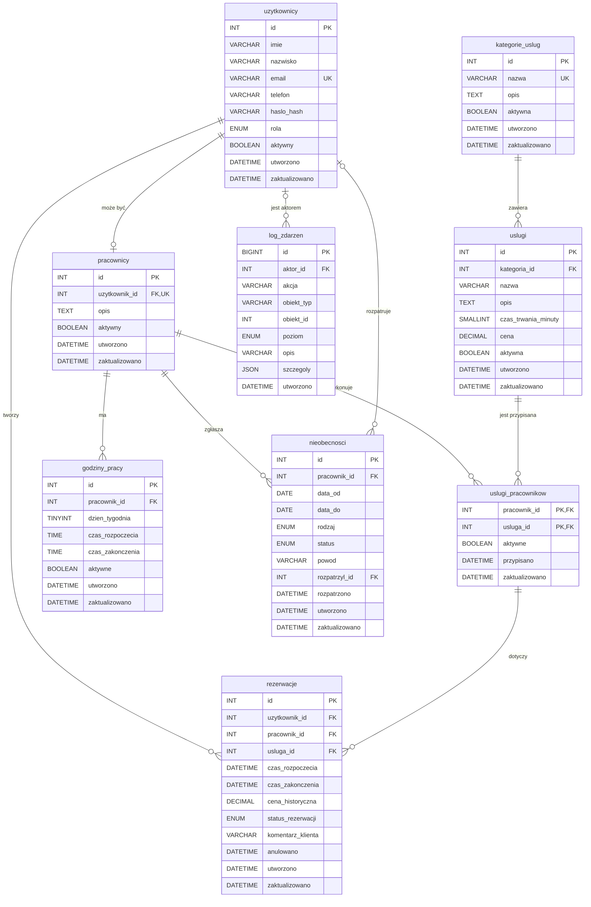

# WeFixIT

System rezerwacji dla serwisu komputerowego. Obsługuje klientów, pracowników i administratorów.

**Wersja online:** <https://wefixit.dziaslo.dev>

## Spis treści

- [Technologie](#technologie)
- [Baza danych](#baza-danych)
  - [Opis tabel nieobecnosci i log_zdarzen](#opis-tabel-nieobecnosci-i-log_zdarzen)
- [Zakres projektu](#zakres-projektu)
  - [Zrealizowano w Etapie 1](#zrealizowano-w-etapie-1)
  - [Zrealizowano w Etapie 2 - Użytkownicy i logowanie](#zrealizowano-w-etapie-2---użytkownicy-i-logowanie)
  - [Zrealizowano w Etapie 3 — panel administratora](#zrealizowano-w-etapie-3--panel-administratora)
    - [Endpointy administracyjne](#endpointy-administracyjne)
    - [Reguły walidacji i obsługa zależności](#reguły-walidacji-i-obsługa-zależności)
    - [Eksport CSV](#eksport-csv)
  - [Zrealizowano w Etapie 4 — klient i rezerwacje](#zrealizowano-w-etapie-4--klient-i-rezerwacje)
    - [Strony i panele Etapu 4](#strony-i-panele-etapu-4)
    - [Proces rezerwacji i reguły dostępności](#proces-rezerwacji-i-reguły-dostępności)
    - [Endpointy Etapu 4](#endpointy-etapu-4)
    - [Historia zmian statusu](#historia-zmian-statusu)
  - [Funkcje dodatkowe](#funkcje-dodatkowe)
- [Wymagania](#wymagania)
  - [Konfiguracja środowiska](#konfiguracja-środowiska)
- [Uruchomienie przez Docker](#uruchomienie-przez-docker)
- [Uruchomienie przez XAMPP](#uruchomienie-przez-xampp)
- [Testy integracyjne i CI](#testy-integracyjne-i-ci)
  - [Zakres plików testowych](#zakres-plików-testowych)
  - [Wymagania testów](#wymagania-testów)
  - [Konfiguracja](#konfiguracja)
  - [Uruchomienie testów](#uruchomienie-testów)
- [Autorzy](#autorzy)

## Technologie
Projekt wykorzystuje następujące technologie:
- PHP 8.2 + Apache, PDO
- MariaDB 11.4
- HTML5, Tailwind CSS 4.3.3 standalone CLI, vanilla JS
- Docker Compose v2, kompatybilność XAMPP

## Baza danych
Wykorzystywana jest baza danych MariaDB. Pusta wersja znajduje się w pliku [database-czysta.sql](database/database-czysta.sql), a wersja z danymi testowymi w [database.sql](database/database.sql).

Poniżej znajduje się diagram wykorzystywanej bazy danych.




Diagram pokazuje logiczne typy i relacje. W schemacie wszystkie typy całkowite
(`INT`, `SMALLINT`, `TINYINT`) są `UNSIGNED`, a `log_zdarzen.id` to
`BIGINT UNSIGNED`; kolumny `VARCHAR` i `DECIMAL` mają długości i precyzję z
[database-czysta.sql](database/database-czysta.sql). Pełne ograniczenia
`NOT NULL`, `CHECK`, `UNIQUE` i indeksy również opisuje plik SQL.

### Opis tabel nieobecnosci i log_zdarzen

- `nieobecnosci` przechowuje urlopy, choroby i inne nieobecności pracowników w zakresie dat. Status `oczekujaca` oznacza wniosek przed decyzją, a `zatwierdzona`, `odrzucona` lub `anulowana` — jego rozstrzygnięcie. Pełny workflow (wniosek, zatwierdzenie, odrzucenie, anulowanie) obsługuje panel: `POST` tworzy zawsze status `oczekujaca`, a `PATCH` wykonuje wyłącznie dozwolone przejścia. Przy zatwierdzeniu lub odrzuceniu `rozpatrzyl_id` pochodzi z sesji administratora i jest zapisywany razem z `rozpatrzono`; przy anulowaniu oba pola są zerowane. `CHECK chk_nieobecnosci_rozpatrzenie` wymaga obu pól dla `zatwierdzona`/`odrzucona` i obu pustych dla `oczekujaca`/`anulowana`. Anulowanie nie usuwa wniosku.
- `log_zdarzen` jest dziennikiem audytowym operacji administracyjnych. Zapisuje aktora, akcję, typ i identyfikator obiektu, poziom (`info`, `warning`, `critical`), opis oraz opcjonalne szczegóły w formacie JSON. Widok dziennika pokazuje aktora tylko jako imię i nazwisko — bez e-maila i telefonu. Kolumny `obiekt_typ` i `obiekt_id` są wypełniane razem albo oba pozostają puste; pilnuje tego `CHECK chk_log_zdarzen_obiekt`, a `log_event()` normalizuje niepełną parę do dwóch wartości `NULL`. Filtry akcji, poziomu i typu obiektu pochodzą z allowlist w `app/log_view.php`. Dziennik nie zastępuje danych biznesowych, tylko dokumentuje zmiany i nie zawiera haseł ani tokenów.

### Wersja pusta
Pusta edycja bazy danych jak sama nazwa wskazuje nie zawiera żadnych danych w sobie. Zalecane użycie w środowisku produkcyjnym.

### Wersja testowa
Testowa edycja bazy danych zawiera wszystko co wersja pusta plus dane testowe. Zalecana ona jest do użycia w celach testowych.

Daty rezerwacji w wersji testowej są liczone względem `CURDATE()` i dopasowane do grafiku pracowników. Rezerwacja na dziś powstaje tylko w dni robocze; w weekend odpowiednik statusu `w_trakcie` trafia na najbliższy poniedziałek.

#### Konta testowe

| Rola | Imię i nazwisko | E-mail | Hasło |
|------|-----------------|--------|-------|
| Administrator | Administrator Systemu | `admin@wefixit.pl` | `haslo123` |
| Pracownik | Tomasz Serwisant | `tomasz.serwisant@wefixit.pl` | `haslo123` |
| Pracownik | Marcin Elektronik | `marcin.elektronik@wefixit.pl` | `haslo123` |
| Pracownik | Kamil Testowy | `kamil.testowy@wefixit.pl` | `haslo123` |
| Klient | Jan Kowalski | `jan.kowalski@example.com` | `haslo123` |
| Klient | Anna Nowak | `anna.nowak@example.com` | `haslo123` |
| Klient | Piotr Wiśniewski | `piotr.wisniewski@example.com` | `haslo123` |

Łącznie jest 7 kont: 1 administrator, 3 pracowników i 3 klientów. Kamil Testowy
jest kontem pracownika bez profilu w tabeli `pracownicy`.

Wszystkie konta testowe mają identyczny `haslo_hash`, ponieważ korzystają ze wspólnego hasła testowego `haslo123`. To zamierzone ułatwienie środowiska testowego — hashy nie należy zmieniać pojedynczo ani używać tego hasła poza testami.

## Zakres projektu

WeFixIT to system rezerwacji dla serwisu komputerowego z trzema rolami: klient, pracownik, administrator.

### Zrealizowano w Etapie 1

- Schemat bazy MariaDB 11.4: 9 tabel (`uzytkownicy`, `pracownicy`, `kategorie_uslug`, `uslugi`, `uslugi_pracownikow`, `godziny_pracy`, `nieobecnosci`, `rezerwacje`, `log_zdarzen`).
- Relacje 1:N oraz relacja N:M pracownik–usługa przez `uslugi_pracownikow`.
- Integralność: klucze obce, `UNIQUE` na e-mail, `CHECK` na ceny / czasy / statusy, `ON DELETE RESTRICT`.
- Aktualny diagram ERD w Mermaid powyżej.
- Dane testowe: 1 administrator, 3 konta pracowników (w tym jedno bez profilu), 3 klientów, usługi, grafik i rezerwacje.
- Środowisko uruchomieniowe: Docker Compose dev + prod oraz instrukcja pod XAMPP.

### Zrealizowano w Etapie 2 - Użytkownicy i logowanie

- Rejestracja konta klienta z walidacją po stronie serwera i rolą ustawianą przez serwer.
- Logowanie i wylogowanie z obsługą sesji PHP, ochroną CSRF i odświeżaniem identyfikatora sesji.
- Podział na role: klient, pracownik, administrator.
- Ochrona stron i endpointów przed dostępem bez sesji lub bez wymaganej roli.
- Profil użytkownika: podgląd i edycja imienia, nazwiska, e-maila i telefonu.
- Ciemny motyw zależny od preferencji systemu, wspólny layout oraz powiadomienia toast.

#### Role i dostęp

| Rola | Dostęp |
|------|--------|
| Niezalogowany | `/login`, `/register`, `/oferta`, `/usluga?id=…`, `POST /api/auth/login`, `POST /api/auth/register` |
| Klient (`klient`) | `/oferta`, `/usluga?id=…`, `/rezerwacja`, `/panel`, `/profil`, `GET /api/me`, `PATCH /api/profile`, `GET /api/availability`, `POST /api/reservations`, `PATCH /api/client-reservations` |
| Pracownik (`pracownik`) | `/oferta`, `/usluga?id=…`, `/rezerwacja`, `/panel`, `/pracownik`, `/profil`, `GET /api/me`, `PATCH /api/profile`, `GET /api/availability`, `PATCH /api/employee-reservations` |
| Administrator (`admin`) | jak pracownik oraz `/admin`, `/kategorie`, `/uslugi`, `/pracownicy`, `/pracownicy-uslugi?id=…`, `/pracownicy-dostepnosc?id=…`, `/uzytkownicy`, `/rezerwacje`, `/log`, `/eksport?typ=rezerwacje`, `/eksport?typ=uzytkownicy` i `/api/admin/*` |

Rola jest sprawdzana po stronie serwera na każdej chronionej stronie przez
`require_role()` i na każdym chronionym endpointcie przez `require_api_login()`
oraz porównanie pola `rola`. Widoczność pozycji w menu (`panel_menu_items()`)
jest tylko wygodą interfejsu. Klient i pracownik, którzy ręcznie wpiszą adres
`/admin`, `/kategorie`, `/uzytkownicy` lub innej strony administracyjnej,
otrzymają odpowiedź 403. Bez sesji strona przekierowuje na `/login`, a endpoint
API zwraca 401. `auth_base_path()` sprawia, że linki i przekierowania działają
także w podkatalogu XAMPP.

Konto klienta powstaje wyłącznie przez rejestrację. Rolę zawsze ustala serwer,
więc pola `rola` i `aktywny` przesłane w formularzu są ignorowane. Strona
`/register` tworzy konto z rolą `klient`, a `/pracownik` i `/admin` wymagają
odpowiednio roli pracownika i administratora.

Panel `/pracownicy` nie tworzy nowych kont użytkowników. Tworzy wyłącznie
profil pracownika powiązany z istniejącym, aktywnym kontem o roli `pracownik`.
Rejestracja kont ma własną ścieżkę, a nadanie roli pracownika wymaga świadomej
decyzji administratora.

#### Endpointy JSON

| Metoda i adres | CSRF | Najważniejsze kody odpowiedzi |
|----------------|------|-------------------------------|
| `POST /api/auth/register` | tak | 201 sukces, 409 zajęty e-mail, 422 błędy walidacji, 415 zły `Content-Type` |
| `POST /api/auth/login` | tak | 200 sukces z rolą, 401 błędne dane logowania, 422 błędy walidacji, 415 zły `Content-Type` |
| `POST /api/auth/logout` | tak | 200 sukces, 403 brak CSRF, 405 zła metoda |
| `GET /api/me` | nie | 200 dane zalogowanego użytkownika, 401 brak sesji |
| `PATCH /api/profile` | tak | 200 sukces, 401 brak sesji, 403 brak CSRF, 409 zajęty e-mail, 422 błędy walidacji |
| `POST /api/admin/categories` | tak | 201 sukces, 409 nazwa zajęta, 422 walidacja |
| `PATCH /api/admin/categories` | tak | 200 sukces, 404 brak kategorii, 409 nazwa zajęta, 422 walidacja lub brak pól |
| `DELETE /api/admin/categories` | tak | 200 sukces, 400 zły JSON, 404 brak kategorii, 409 kategoria ma usługi, 422 zły `id` |
| `POST /api/admin/services` | tak | 201 sukces, 409 nazwa zajęta w kategorii, 422 walidacja |
| `PATCH /api/admin/services` | tak | 200 sukces, 404 brak usługi, 409 nazwa zajęta, 422 walidacja lub brak pól |
| `DELETE /api/admin/services` | tak | 200 sukces, 400 zły JSON, 404 brak usługi, 409 usługa ma przypisania lub rezerwacje, 422 zły `id` |
| `POST /api/admin/employees` | tak | 201 sukces, 409 konto ma już profil, 422 walidacja konta lub opisu |
| `PATCH /api/admin/employees` | tak | 200 sukces, 404 brak profilu, 422 walidacja lub próba zmiany konta |
| `DELETE /api/admin/employees` | tak | 200 sukces, 400 zły JSON, 404 brak profilu, 409 profil ma zależności, 422 zły `id` |
| `POST /api/admin/employee-services` | tak | 200 sukces, 404 brak pracownika, 422 niepoprawna lista lub usługa nieaktywna |
| `POST /api/admin/employee-schedule` | tak | 201 sukces, 404 brak pracownika, 422 walidacja, nakładanie lub duplikat |
| `PATCH /api/admin/employee-schedule` | tak | 200 sukces, 404 brak wpisu lub niezgodny pracownik, 422 walidacja lub kolizja |
| `DELETE /api/admin/employee-schedule` | tak | 200 sukces, 400 zły JSON, 404 brak wpisu lub niezgodny pracownik, 422 walidacja |
| `POST /api/admin/employee-absences` | tak | 201 sukces, 404 brak pracownika, 422 walidacja lub nakładanie |
| `PATCH /api/admin/employee-absences` | tak | 200 sukces (opcjonalne ostrzeżenie o rezerwacjach), 404 brak wniosku, 422 niedozwolone przejście |
| `PATCH /api/admin/users` | tak | 200 sukces, 404 brak konta, 422 walidacja, reguła ostatniego administratora lub własne konto |
| `GET /api/admin/reservations` | nie | 200 lista z metadanymi paginacji, 401 brak sesji, 403 brak roli |
| `PATCH /api/admin/reservations` | tak | 200 sukces, 404 brak rezerwacji, 422 walidacja lub niedozwolone przejście |

Endpointy administracyjne mogą dodatkowo zwrócić 400 (uszkodzony JSON),
401 (brak sesji), 403 (rola inna niż `admin` albo błędny CSRF), 405 (zła
metoda z nagłówkiem `Allow`), 415 (zły `Content-Type` dla POST/PATCH) i 500
(błąd serwera bez szczegółów technicznych). Publiczne adresy nie mają
rozszerzenia `.php`; Apache mapuje je na pliki w `public/` zgodnie z
[`public/.htaccess`](public/.htaccess).

Token CSRF przesyłany jest w nagłówku `X-CSRF-Token`. Body żądań i odpowiedzi
są w formacie JSON (`Content-Type: application/json`). `GET /api/me` nigdy nie
zwraca `haslo_hash` ani `aktywny`.

#### Sesja i CSRF

Sesja korzysta z cookie `PHPSESSID` ustawionego jako `HttpOnly` i `SameSite=Lax`;
flaga `Secure` jest dodawana, gdy aplikacja działa po HTTPS. Po zalogowaniu
identyfikator sesji jest odświeżany (`session_regenerate_id`), a token CSRF
rotowany. Operacje zmieniające stan wymagają nagłówka `X-CSRF-Token` zgodnego
z tokenem zapisanym w sesji. Formularze korzystają z `fetch()` i wymagają
włączonego JavaScriptu.

### Zrealizowano w Etapie 3 — panel administratora

Panel administratora jest dostępny wyłącznie dla roli `admin`. Publiczne
adresy nie mają rozszerzenia `.php`; Apache mapuje je na pliki w `public/`
zgodnie z regułą z [`public/.htaccess`](public/.htaccess). Każda strona
wywołuje `require_role(['admin'])`, a każdy endpoint sprawdza sesję i rolę po
stronie serwera.

| Moduł i ścieżka publiczna | Rola | Zakres |
|---------------------------|------|--------|
| Strona główna — `/admin` | `admin` | Panel startowy administratora: pokazuje liczbę klientów, aktywnych pracowników, usług (w tym aktywnych), rezerwacji łącznie i rezerwacji na dziś. Tylko odczyt; nie zarządza danymi. |
| Kategorie — `/kategorie` | `admin` | Lista z wyszukiwaniem i paginacją, dodawanie i edycja, aktywacja/dezaktywacja oraz usuwanie kategorii bez usług. Nie przypisuje usług do kategorii; kategoria z usługami nie zostanie usunięta (409). |
| Usługi — `/uslugi` | `admin` | Lista z filtrami kategorii i statusu, wyszukiwaniem i paginacją; dodawanie i edycja nazwy, opisu, kategorii, ceny i czasu trwania, a także aktywacja/dezaktywacja. Nie przypisuje pracowników; usługa z przypisaniem lub rezerwacją nie zostanie usunięta (409). |
| Pracownicy — `/pracownicy` | `admin` | Lista, wyszukiwanie i paginacja; tworzenie profilu tylko dla istniejącego, aktywnego konta o roli `pracownik`, które nie ma jeszcze profilu; edycja opisu i aktywności oraz usuwanie profilu bez zależności. Nie tworzy ani nie usuwa kont użytkowników i nie zmienia ich ról. |
| Usługi pracownika — `/pracownicy-uslugi?id=N` | `admin` | Ustawia cały zbiór przypisań usług do wskazanego pracownika. Przypisać można tylko aktywne usługi; odłączenie zapisuje `aktywne = FALSE` bez usuwania wiersza, więc historia i rezerwacje pozostają spójne. |
| Dostępność pracownika — `/pracownicy-dostepnosc?id=N` | `admin` | Zarządza tygodniowym grafikiem (dodanie, aktywacja/dezaktywacja i usunięcie wpisu z kontrolą nakładania) oraz wnioskami o nieobecność (utworzenie, zatwierdzenie, odrzucenie, anulowanie). Nie tworzy rezerwacji i nie anuluje ich automatycznie; przy zatwierdzaniu pokazuje ostrzeżenie o rezerwacjach w okresie. |
| Użytkownicy — `/uzytkownicy` | `admin` | Lista z filtrami roli i statusu oraz wyszukiwaniem; zmiana roli i aktywacja/dezaktywacja konta. Nie tworzy, nie usuwa kont i nie zmienia haseł; chroni własne konto oraz ostatniego aktywnego administratora. |
| Rezerwacje — `/rezerwacje` | `admin` | Lista z filtrami, wyszukiwaniem, sortowaniem i paginacją; zmiana statusu według zamkniętej maszyny stanów, w tym anulowanie i cofnięcie anulowania. Nie tworzy rezerwacji ani nie usuwa ich. |
| Dziennik zdarzeń — `/log` | `admin` | Odczyt dziennika z filtrami akcji, poziomu, obiektu i dat oraz paginacją; szczegóły JSON są dostępne w widoku. Tylko odczyt, bez edycji i usuwania wpisów. |
| Eksport CSV — `/eksport?typ=rezerwacje` i `/eksport?typ=uzytkownicy` | `admin` | Generuje plik CSV odpowiednio rezerwacji lub użytkowników, z filtrami przekazanymi z widoku listy. Tylko odczyt; nie wymaga CSRF i nie zapisuje zdarzenia w dzienniku. |

Menu administratora prowadzi też do podglądów `/panel` i `/pracownik` oraz do
`/profil`; te pozycje pochodzą z Etapu 2 i nie zmieniają danych administracyjnych.

Czego panel nie robi:

- nie tworzy rezerwacji — to zakres Etapu 4;
- nie tworzy ani nie usuwa kont użytkowników: konto klienta powstaje przez
  `/register`, a panel może tylko zmienić rolę lub aktywować/dezaktywować konto;
- nie usuwa rezerwacji: anulowanie jest zmianą `status_rezerwacji` na
  `anulowana` i ustawieniem `anulowano` w tej samej instrukcji `UPDATE`;
- nie usuwa nieobecności: anulowanie wniosku jest zmianą jego statusu;
- nie usuwa wpisów dziennika zdarzeń.

#### Endpointy administracyjne

Wszystkie endpointy administracyjne znajdują się w tabeli w sekcji
[Endpointy JSON](#endpointy-json) i mają wspólny prefiks `/api/admin/`.
Kolejność sprawdzeń jest stała: metoda HTTP, `Content-Type` (tylko dla POST
i PATCH), sesja, rola `admin`, CSRF (dla POST, PATCH i DELETE), a na końcu body
JSON (dla POST/PATCH oraz DELETE, który czyta `id`). `GET /api/admin/reservations`
kończy się na sprawdzeniu roli. Dlatego zła metoda daje 405 także bez sesji, a
zły `Content-Type` daje 415 przed sprawdzeniem roli.

- CSRF jest wymagany dla każdej zmiany stanu, czyli POST, PATCH i DELETE.
  Wyjątkiem jest `GET /api/admin/reservations`, który tylko czyta dane i nie
  wymaga tokenu. Brak lub niepoprawny token daje 403.
- `Content-Type: application/json` jest wymagany dla POST i PATCH. DELETE nie
  wymaga tego nagłówka, ale nadal odczytuje body JSON z `id`; uszkodzone lub
  puste body daje 400.
- `employee-services` przyjmuje wyłącznie POST. Zastępuje cały zbiór przypisań
  pracownika i jest idempotentny; zła metoda daje 405 z `Allow: POST`.
- `employee-absences` przyjmuje POST i PATCH. DELETE celowo nie istnieje, bo
  anulowanie jest zmianą statusu; zła metoda daje 405 z `Allow: POST, PATCH`.
- `users` przyjmuje wyłącznie PATCH. Nie ma POST ani DELETE, bo panel nie
  tworzy i nie usuwa kont; zła metoda daje 405 z `Allow: PATCH`.
- `reservations` przyjmuje GET i PATCH. Nie ma DELETE, bo rezerwacji nie
  usuwamy; zła metoda daje 405 z `Allow: GET, PATCH`.
- Pozostałe endpointy administracyjne (`categories`, `services`, `employees`,
  `employee-schedule`) przyjmują POST, PATCH i DELETE.
- `employee-schedule` przy PATCH i DELETE wymaga zgodności `pracownik_id` z
  wpisem grafiku. Samo `id` nie wystarcza; niezgodny właściciel daje 404.
- `employee-services` odłącza tylko przypisania do aktywnych usług, których nie
  ma w żądaniu, i nigdy nie wykonuje `DELETE` na `uslugi_pracownikow`.
  Przypisania do usług nieaktywnych pozostają zachowane, ale nie można ich
  przypisać ponownie.

`GET /api/admin/reservations` przyjmuje `page` i `size` oraz filtry `data_od`,
`data_do`, `status`, `pracownik_id`, `usluga_id`, `uzytkownik_id`, `kierunek`
i `szukaj`. Odpowiedź ma stały kształt:

```json
{
  "success": true,
  "rezerwacje": [],
  "paginacja": {
    "strona": 1,
    "rozmiar": 25,
    "stron": 1,
    "razem": 0
  }
}
```

`size` należy do allowlisty `1`, `2`, `10`, `25`, `50`, `100` (domyślnie 25);
niepoprawna wartość wraca do 25. Rozmiar strony jest parametrem adresu i nie ma
na to kontrolki w interfejsie: wartość pochodzi z query stringu albo przyjmuje
domyślne 25. Wartości `1` i `2` pozostają w allowliście jako dolna granica
techniczna wykorzystywana przez testy. `page` mniejsze od 1 daje stronę 1, a strona
powyżej zakresu jest sprowadzana do ostatniej. `stron` ma minimum 1, także dla
pustego wyniku. `kierunek` przyjmuje `asc` lub `desc` (domyślnie `desc`).
`szukaj` obejmuje nazwisko klienta i pracownika. `LIMIT` i `OFFSET` są
budowane jako literały z wartości już zwalidowanych, ponieważ PDO i MariaDB
nie przyjmują ich jako parametrów prepared statement.

#### Reguły walidacji i obsługa zależności

Panel preferuje dezaktywację zamiast usuwania, bo schemat chroni historię
kluczami obcymi `ON DELETE RESTRICT`:

- `uslugi.kategoria_id` → `kategorie_uslug.id`;
- `pracownicy.uzytkownik_id` → `uzytkownicy.id`;
- `uslugi_pracownikow.pracownik_id` → `pracownicy.id` oraz
  `uslugi_pracownikow.usluga_id` → `uslugi.id`;
- `godziny_pracy.pracownik_id` → `pracownicy.id`;
- `nieobecnosci.pracownik_id` → `pracownicy.id` oraz
  `nieobecnosci.rozpatrzyl_id` → `uzytkownicy.id`;
- `rezerwacje.uzytkownik_id` → `uzytkownicy.id` oraz para
  `(rezerwacje.pracownik_id, rezerwacje.usluga_id)` →
  `uslugi_pracownikow (pracownik_id, usluga_id)`;
- `log_zdarzen.aktor_id` → `uzytkownicy.id`.

Dzięki tym ograniczeniom nie da się usunąć konta, które ma profil pracownika,
rezerwację, nieobecność lub wpis w logu, ani usługi, do której istnieje
przypisanie lub rezerwacja. `rezerwacje.cena_historyczna` zapisuje cenę z
chwili rezerwacji, więc późniejsza zmiana ceny usługi nie zmienia historii.
Dlatego panel dezaktywuje rekordy przez `aktywny`, `aktywna` lub `aktywne`.
Wyjątki bez zależności mogą być usunięte fizycznie: kategoria bez usług,
usługa bez przypisań i rezerwacji, profil pracownika bez powiązań oraz wpis
grafiku, do którego nie prowadzi żaden klucz obcy.

Serwer egzekwuje reguły, których nie da się wyrazić samym schematem:

- **Nakładanie przedziałów grafiku.** `UNIQUE` `uq_godziny_pracy_przedzial`
  obejmuje `pracownik_id`, `dzien_tygodnia`, `czas_rozpoczecia` i
  `czas_zakonczenia`, więc blokuje tylko identyczny przedział. Nachodzące
  przedziały sprawdza `pracownik_schedule_create()` oraz reaktywacja w
  `pracownik_schedule_set_active()`: blokują profil `FOR UPDATE` i używają
  warunku `existing.start < new.end AND existing.end > new.start`. Przedziały
  stykające się granicami nie kolidują, a dokładny duplikat dostaje osobny
  komunikat z naruszenia `UNIQUE`.
- **Ostatni aktywny administrator.** Baza nie ma constraintu „co najmniej
  jeden admin”. `uzytkownik_update()` blokuje wiersze administratorów w
  kolejności `id`, sprawdza, czy operacja nie odbiera roli lub nie dezaktywuje
  ostatniego aktywnego administratora, i blokuje też odebranie roli oraz
  dezaktywację własnego konta.
- **Niezmienny `uzytkownik_id` profilu pracownika.** `PATCH /api/admin/employees`
  przyjmuje to pole, ale próba zmiany na inne konto kończy się 422
  `Powiązanie konta jest niezmienne. Zmiana konta wymaga utworzenia nowego
  profilu.` Baza ma tu tylko klucz obcy i `UNIQUE`, bez triggera pilnującego
  historii powiązania.
- **Brak przypisania usługi nieaktywnej.** `employee-services` przyjmuje
  wyłącznie identyfikatory usług z `uslugi.aktywna = TRUE`. Usługa nieaktywna
  może pozostać w historii przypisań, ale nie można jej przypisać ponownie;
  schemat nie ma `CHECK` wiążącego `uslugi_pracownikow.aktywne` z
  `uslugi.aktywna`.
- **Nakładanie nieobecności.** `pracownik_absence_overlap_exists()` odrzuca
  wniosek, jeśli w tym samym okresie istnieje nieobecność o statusie innym niż
  `odrzucona` lub `anulowana`. Baza nie ma constraintu wykluczającego
  nakładanie zakresów dat.
- **Maszyny stanów.** Dozwolone przejścia rezerwacji i nieobecności są
  zamkniętymi listami w `app/rezerwacje.php` i `app/pracownicy_dostepnosc.php`.
  Baza dopuszcza każdy status z `ENUM`, więc to serwer pilnuje kolejności zmian.

Rezerwacje mają następującą maszynę stanów:

| Stan bieżący | Dozwolone przejścia |
|--------------|---------------------|
| `oczekujaca` | `potwierdzona`, `anulowana` |
| `potwierdzona` | `w_trakcie`, `anulowana` |
| `w_trakcie` | `zrealizowana`, `anulowana` |
| `zrealizowana` | brak — stan końcowy |
| `anulowana` | `oczekujaca` |

`zrealizowana` jest stanem końcowym, bo usługa została wykonana i dalsza
zmiana statusu zafałszowałaby historię. `anulowana` nie jest terminalna:
można ją przywrócić wyłącznie do `oczekujaca`, żeby cofnięcie anulowania nie
pomijało ponownego potwierdzenia.

Nieobecności mają następującą maszynę stanów:

| Stan bieżący | Dozwolone przejścia |
|--------------|---------------------|
| `oczekujaca` | `zatwierdzona`, `odrzucona`, `anulowana` |
| `zatwierdzona` | `anulowana` |
| `odrzucona` | brak — stan końcowy |
| `anulowana` | brak — stan końcowy |

`odrzucona` jest stanem końcowym, bo decyzja odmowna zamyka wniosek i ponowne
rozpatrzenie wymaga nowego wniosku. `anulowana` również jest stanem końcowym,
bo wycofany wniosek nie wraca do obiegu. `zatwierdzona` nie jest terminalna —
można ją anulować.

`CHECK chk_rezerwacje_anulowanie` wymaga, aby status `anulowana` miał niepuste
`anulowano`, a każdy inny status miał `anulowano = NULL`. Dlatego
`rezerwacja_set_status()` wykonuje jeden `UPDATE`, który ustawia
`status_rezerwacji` i `anulowano` razem: `NOW()` przy anulowaniu i `NULL` przy
pozostałych przejściach. Rozdzielenie tych zapisów na dwie instrukcje
naruszyłoby CHECK po pierwszej z nich. Analogicznie
`CHECK chk_nieobecnosci_rozpatrzenie` wymaga jednoczesnego zapisu
`rozpatrzyl_id` i `rozpatrzono` dla `zatwierdzona`/`odrzucona` oraz obu
wartości `NULL` dla `oczekujaca`/`anulowana`; `pracownik_absence_set_status()`
zapisuje te pola w jednej instrukcji `UPDATE`.

#### Eksport CSV

Panel udostępnia dwa eksporty: `/eksport?typ=rezerwacje` i
`/eksport?typ=uzytkownicy` (wymagana rola `admin`). Eksport rezerwacji
zachowuje filtry z widoku listy: zakres dat, status, pracownika, usługę,
klienta, kierunek sortowania i frazę wyszukiwania. Eksport użytkowników
zachowuje filtr roli, statusu i wyszukiwania. Eksport nie ma paginacji —
zawiera wszystkie rekordy spełniające filtry.

Plik jest kodowany w UTF-8 z BOM, a separatorami pól są średniki. Komórki
rozpoczynające się od `=`, `+`, `-`, `@`, tabulatora, CR lub LF są
neutralizowane apostrofem, żeby arkusz nie wykonał formuły pochodzącej z
danych. Eksport jest wyłącznie odczytem: nie wymaga CSRF i nie zapisuje wpisu
w dzienniku zdarzeń. Eksport użytkowników nie zawiera telefonu ani hasła;
eksport rezerwacji zawiera e-mail klienta jako część dokumentu rezerwacji.

### Zrealizowano w Etapie 4 — klient i rezerwacje

Etap 4 domyka ścieżkę klienta i pracownika: publiczną ofertę usług, wyliczanie
wolnych terminów, formularz tworzenia rezerwacji, panel klienta z anulowaniem
własnej przyszłej wizyty, panel pracownika ze zmianą statusu przypisanych
rezerwacji oraz prezentację historii zmian statusu. Schemat bazy danych nie
zmienił się względem wcześniejszych etapów, dlatego diagram ERD powyżej
pozostaje świadomie bez zmian.

#### Strony i panele Etapu 4

| Ścieżka publiczna | Dostęp | Zakres |
|-------------------|--------|--------|
| `/oferta` | publiczny | Lista aktywnych usług w aktywnych kategoriach z filtrem kategorii, czasem trwania, ceną i informacją o dostępności aktywnego wykonawcy. |
| `/usluga?id=N` | publiczny | Szczegóły pojedynczej aktywnej usługi, lista przypisanych aktywnych pracowników oraz warunkowy przycisk CTA zależny od sesji i roli. |
| `/rezerwacja` | zalogowany użytkownik (`require_login()`) | Formularz wyboru usługi, pracownika, daty, godziny i komentarza; mapa pracowników przekazywana jest w `data-employees`, a wolne terminy pobierane są przez AJAX. Pozycja w menu bocznym jest widoczna dla `klient` i `admin`. |
| `/panel` | zalogowany użytkownik (`require_login()`) | Panel klienta z rozłącznymi sekcjami „Nadchodzące” i „Historia”, przyciskiem anulowania przyszłych rezerwacji (`oczekujaca`, `potwierdzona`) oraz rozwijaną historią zmian `<details>`. |
| `/pracownik` | `pracownik`, `admin` | Panel pracownika z rozłącznymi sekcjami „Dzisiaj”, „Nadchodzące” i „Historia”, danymi kontaktowymi klienta, przyciskami maszyny stanów przypisanych wizyt i historią zmian `<details>`. Dla administratora wyświetla kartę informacyjną o braku profilu pracownika z linkiem do `/rezerwacje`. |

#### Proces rezerwacji i reguły dostępności

Proces składania rezerwacji przebiega w stałej kolejności:
**usługa → pracownik → data → godzina → potwierdzenie**.

1. Wybór usługi zawęża listę pracowników do aktywnych wykonawców przypisanych
   do tej usługi (`data-employees` przebudowywane w JavaScripcie bez duplikatów
   i bez polegania na `option[hidden]`).
2. Wybór pracownika i daty uruchamia żądanie `GET /api/availability`, które
   zwraca wolne przedziały czasowe; licznik żądań w skrypcie odrzuca spóźnione
   odpowiedzi sieciowe.
3. Wybór godziny odblokowuje wysłanie formularza przez `POST /api/reservations`
   z nagłówkiem `X-CSRF-Token`. Formularz rezerwacji wymaga włączonego
   JavaScriptu — strona `/rezerwacja` nie obsługuje klasycznego `POST` ani
   fallbacku bez JS.

Wyliczanie dostępności i zapis rezerwacji opierają się na wspólnych regułach:

- **Horyzont 14 dni i siatka 15 minut.** Rezerwacje można składać wyłącznie od
  bieżącego dnia do 13 dni naprzód (łącznie 14 dni kalendarzowych), co zapobiega
  blokowaniu odległych terminów przed ustaleniem urlopów. Krok siatki wynosi
  15 minut, ale po każdym wygenerowanym slocie kursor przesuwa się o pełny czas
  trwania usługi, dzięki czemu zwracane propozycje nie nachodzą na siebie i
  odzwierciedlają rzeczywistą przepustowość pracownika. Sloty zaczynające się
  w przeszłości lub dokładnie w bieżącej chwili (`start <= now`) są odrzucane.
- **Reguła konfliktu przedziałów.** Dwa przedziały `[start, end)` kolidują wtedy
  i tylko wtedy, gdy zachodzi warunek:

  ```text
  existing.start < new.end AND existing.end > new.start
  ```

  Przedziały stykające się granicami (`existing.end = new.start` lub
  `existing.start = new.end`) nie kolidują. Ta sama funkcja sprawdza nakładanie
  z istniejącymi rezerwacjami (o statusie innym niż `anulowana`) oraz
  mieszczanie się wizyty wewnątrz aktywnego przedziału `godziny_pracy` przy
  braku zatwierdzonej lub oczekującej `nieobecnosci` w danym dniu.
- **Blokada wiersza i rewalidacja w transakcji.** Samo `BEGIN` nie chroni przed
  wyścigiem dwóch równoległych żądań na ten sam wolny termin. Dlatego
  `reservation_create()` jako pierwszą instrukcję po `beginTransaction()`
  wykonuje `SELECT id FROM pracownicy WHERE id = :id FOR UPDATE` (oraz blokuje
  wiersz klienta i usługi), a dopiero po przejęciu blokady ponownie sprawdza
  aktywność konta klienta, pracownika i usługi, przypisanie w
  `uslugi_pracownikow`, grafik, nieobecności i brak konfliktu terminów. Cenę
  historyczną (`cena_historyczna`), status początkowy (`oczekujaca`) i godzinę
  zakończenia zawsze wylicza serwer.

#### Endpointy Etapu 4

| Metoda i adres | CSRF | Najważniejsze kody odpowiedzi |
|----------------|------|-------------------------------|
| `GET /api/availability` | nie | 200 lista wolnych slotów, 401 brak sesji, 404 brak pracownika lub usługi, 409 nieaktywny wykonawca/usługa lub brak przypisania, 422 błędne parametry lub data poza horyzontem 14 dni |
| `POST /api/reservations` | tak | 201 utworzona rezerwacja, 400 zły JSON, 401 brak sesji, 403 rola inna niż `klient` lub brak CSRF, 409 zajęty/niedostępny termin, 415 zły `Content-Type`, 422 błędy walidacji pól lub data poza horyzontem |
| `PATCH /api/client-reservations` | tak | 200 anulowano rezerwację, 400 zły JSON, 401 brak sesji, 403 rola inna niż `klient`, cudza rezerwacja lub brak CSRF, 404 brak rezerwacji, 409 status lub czas nie pozwala na anulowanie, 415 zły `Content-Type`, 422 błędne `id` |
| `PATCH /api/employee-reservations` | tak | 200 zmieniono status, 400 zły JSON, 401 brak sesji, 403 rola `klient`, brak profilu pracownika lub brak CSRF, 404 brak rezerwacji lub wizyta innego pracownika, 415 zły `Content-Type`, 422 błędy walidacji lub niedozwolone przejście |

#### Historia zmian statusu

Historia zmian statusu rezerwacji w `/panel` i `/pracownik` korzysta wyłącznie z
istniejącej tabeli `log_zdarzen` (`obiekt_typ = 'rezerwacja'`) bez dodawania
nowych tabel ani kolumn w schemacie. Moduł `app/rezerwacje_historia.php`
udostępnia `reservation_history()` oraz `reservation_history_batch()`, które
pobierają zdarzenia `rezerwacja_utworzona`, `rezerwacja_status_zmieniony`,
`rezerwacja_anulowana` i `rezerwacja_anulowana_klient` jednym zapytaniem `IN`
dla wszystkich rezerwacji widocznych na stronie (bez problemu N+1) i dekodują
szczegóły przez `log_view_details_decode()`. Widoki renderują sekcję `<details>`
tylko wtedy, gdy rezerwacja ma zapisane zdarzenia.

### Funkcje dodatkowe

Poniższe funkcje wykraczają poza minimalny zakres projektu i są zaimplementowane
w kodzie:

- Asynchroniczne pobieranie wolnych terminów przez `GET /api/availability` —
  formularz nie blokuje strony i odrzuca spóźnione odpowiedzi sieciowe dzięki
  licznikowi żądań w `public/assets/js/reservation-form.js`.
- Historia zmian statusu rezerwacji z tabeli `log_zdarzen`, pobierana batchowo
  bez N+1 przez `app/rezerwacje_historia.php` i wyświetlana w panelach klienta
  i pracownika.
- Dziennik zdarzeń administratora z filtrami akcji, poziomu i typu obiektu,
  zaimplementowany w `app/log_view.php` i `public/log.php`.
- Eksport CSV rezerwacji i użytkowników z neutralizacją formuł arkusza
  kalkulacyjnego w `public/eksport.php`.
- Wyszukiwanie, filtrowanie i paginacja list administracyjnych wspólne dla
  kategorii, usług, pracowników, użytkowników i rezerwacji.
- Rozbudowany system uprawnień: rola sprawdzana serwerowo, ownership rezerwacji
  oraz maszyna stanów rezerwacji i nieobecności.
- Nieobecności pracowników z pełnym workflow wniosku (`oczekujaca`,
  `zatwierdzona`, `odrzucona`, `anulowana`).
- REST API pod `/api/*` obsługujące AJAX i używające tych samych modułów
  domenowych co widoki SSR.
- 253 automatycznie uruchamiane testy HTTP w CI na MariaDB 11.4, w tym test
  równoległego zajęcia terminu (test 194).
- Wspólna reguła nakładania przedziałów wydzielona do `app/przedzialy.php`
  i używana zarówno przez grafik pracowników, jak i przez rezerwacje.

## Wymagania

Do uruchomienia aplikacji należy wybrać jedną z poniższych metod:

- Docker z obsługą Compose,
- XAMPP z Apache, PHP i MySQL.

### Konfiguracja środowiska

Podstawowym źródłem konfiguracji jest plik `.env`, w szczególności dla
połączenia z bazą danych. [`public/config.php`](public/config.php) najpierw
czyta zmienne środowiskowe, a brakujące wartości uzupełnia z `.env`; dlatego
testy i CI mogą przekazywać `DB_*` bezpośrednio w środowisku. Plik `.env` należy
utworzyć na podstawie `.env.example` i dostosować do wybranego środowiska.
Znajduje się w katalogu głównym projektu, poza katalogiem `public/`, i jest
ignorowany przez Git — nie trafia do repozytorium.

## Uruchomienie przez Docker

Docker uruchamia aplikację razem z serwerem MariaDB i przy pierwszym utworzeniu wolumenu importuje `database/database.sql`. Plik [`docker/docker-compose.dev.yml`](docker/docker-compose.dev.yml) definiuje usługi `wefixit-dev`, `mariadb` i `tailwind-watcher`; konfiguracja pochodzi z [`.env.example`](.env.example) i kopiowanego `.env`.

1. Sklonuj repozytorium i przejdź do jego katalogu:

   ```bash
   git clone https://github.com/Mord0reK/WeFixIT.git
   cd WeFixIT
   ```

2. Utwórz plik `.env` na podstawie `.env.example` i w razie potrzeby zmień hasła:

   ```bash
   cp .env.example .env
   ```

   W pliku `.env` dla Dockera `DB_HOST` musi mieć wartość `mariadb`, bo tak
   nazywa się usługa bazy w `docker/docker-compose.dev.yml`. Zmienna
   `DB_ROOT_PASSWORD` jest używana wyłącznie przez kontener MariaDB; aplikacja
   łączy się przez `DB_USER` i `DB_PASSWORD`.

3. Zbuduj obrazy i uruchom kontenery:

   ```bash
   docker compose --env-file .env -f docker/docker-compose.dev.yml up --build
   ```

   Polecenie wykonuj z katalogu głównego projektu, ponieważ właśnie stamtąd
   Compose wczytuje plik `.env`. 

4. Otwórz aplikację w przeglądarce: [http://localhost:8080](http://localhost:8080).

Aby zatrzymać aplikację, użyj `Ctrl+C` albo uruchom:

```bash
docker compose --env-file .env -f docker/docker-compose.dev.yml down
```

Baza danych jest przechowywana w wolumenie Dockera. Aby rozpocząć od nowej bazy i ponownie załadować dane testowe, usuń także wolumen:

```bash
docker compose --env-file .env -f docker/docker-compose.dev.yml down -v
docker compose --env-file .env -f docker/docker-compose.dev.yml up --build
```

## Uruchomienie przez XAMPP

Uruchomienie przez XAMPP:

1. Zainstalować XAMPP i uruchomić moduły **Apache** oraz **MySQL**.
2. Rozpakować projekt do `C:\xampp\htdocs\WeFixIT` (Windows) albo odpowiednika katalogu `htdocs` na danym systemie.
3. Otworzyć [phpMyAdmin](http://localhost/phpmyadmin), utworzyć bazę `wefixit` i zaimportować plik [database.sql](database/database.sql). Na potrzeby produkcyjne można użyć [database-czysta.sql](database/database-czysta.sql).
4. Utworzyć plik `.env` w katalogu głównym projektu na podstawie `.env.example` i ustawić dane XAMPP. Dla standardowej instalacji użyj:

   ```dotenv
   DB_HOST=localhost
   DB_PORT=3306
   DB_NAME=wefixit
   DB_USER=root
   DB_PASSWORD=
   ```

   Jeśli konto MySQL `root` ma ustawione hasło, wpisz je w `DB_PASSWORD`. Nie należy edytować plików PHP — konfigurację zmienia się wyłącznie w `.env`. `DB_ROOT_PASSWORD` z `.env.example` nie jest potrzebny aplikacji w XAMPP; używa go tylko kontener MariaDB w Dockerze.

5. Otworzyć aplikację pod adresem [http://localhost/WeFixIT/public/](http://localhost/WeFixIT/public/). Publiczne adresy nie mają rozszerzenia `.php`; mapowanie zapewnia [`public/.htaccess`](public/.htaccess). Alternatywnie można skonfigurować VirtualHost z `DocumentRoot` wskazującym na katalog `public/` i używać adresu ustawionego dla tego VirtualHosta.

W środowisku Docker wartość `DB_HOST` musi wynosić `mariadb`; w środowisku XAMPP — `localhost`.

## Testy integracyjne i CI

Testy znajdują się w katalogu [`tests/`](tests/) i sprawdzają aplikację przez HTTP
na bazie wskazanej przez `DB_NAME` (domyślnie `wefixit_test`). Przed każdym
uruchomieniem zestaw usuwa i ponownie tworzy tabele w tej bazie. Nie wskazuj
w `DB_NAME` bazy deweloperskiej (np. `wefixit`) ani bazy z danymi do zachowania.

Zestaw obejmuje testy Etapów 1–4 i uruchamia się przez `php tests/run.php`.
Repozytorium zawiera 253 przypadki testowe w plikach `tests/cases_*.php`, od
`cases_registration.php` do `cases_stage4_regression.php`; pełna lista znajduje
się w tabeli poniżej. Aktualny wynik — liczbę testów poprawnych i niepoprawnych
oraz kontrolę logu serwera — wypisuje samo uruchomienie. Polecenie znajduje się
w sekcji [Uruchomienie testów](#uruchomienie-testów).

### Zakres plików testowych

| Plik | Zakres |
|------|--------|
| [`tests/cases_registration.php`](tests/cases_registration.php) | Rejestracja klienta, odpowiedź 201, zajęty e-mail 409, walidacja 422 i ignorowanie pola `rola`. |
| [`tests/cases_endpoints.php`](tests/cases_endpoints.php) | Kontrakt JSON: 405 z `Allow`, 415 dla złego `Content-Type` i 400 dla uszkodzonego body. |
| [`tests/cases_auth.php`](tests/cases_auth.php) | Logowanie i wylogowanie, rotacja identyfikatora sesji, konto nieaktywne oraz cookie `HttpOnly` i `SameSite=Lax`. |
| [`tests/cases_pages.php`](tests/cases_pages.php) | Ochrona stron, role, przekierowania i widoczność pozycji menu. |
| [`tests/cases_profile.php`](tests/cases_profile.php) | Edycja profilu, CSRF, zajęty e-mail 409 oraz ignorowanie `id` i `roli` z body. |
| [`tests/cases_admin.php`](tests/cases_admin.php) | Statystyki panelu startowego, dostęp tylko dla administratora i brak ujawniania hashy. |
| [`tests/cases_admin_categories.php`](tests/cases_admin_categories.php) | Kategorie: dodawanie, edycja, aktywacja, usuwanie, CSRF, 405 i 415. |
| [`tests/cases_admin_services.php`](tests/cases_admin_services.php) | Usługi: CRUD, filtry, ceny, duplikaty nazw, zależności i kontrakt metod. |
| [`tests/cases_admin_employees.php`](tests/cases_admin_employees.php) | Profile pracowników: wybór konta, niezmienny `uzytkownik_id`, zależności i usuwanie. |
| [`tests/cases_admin_employee_services.php`](tests/cases_admin_employee_services.php) | Zastępowanie całego zbioru przypisań, idempotencja, usługi nieaktywne i zachowanie historii. |
| [`tests/cases_admin_availability.php`](tests/cases_admin_availability.php) | Grafik i nieobecności: nakładanie, maszyna stanów, właściciel wpisu, CSRF i 405. |
| [`tests/cases_admin_users.php`](tests/cases_admin_users.php) | Zmiana roli i statusu, ochrona własnego konta, ostatni administrator i tylko PATCH. |
| [`tests/cases_admin_reservations.php`](tests/cases_admin_reservations.php) | Lista rezerwacji, filtry, maszyna stanów, anulowanie w jednym `UPDATE` i tylko GET/PATCH. |
| [`tests/cases_admin_pagination.php`](tests/cases_admin_pagination.php) | Allowlista `page`/`size`, metadane paginacji, wyszukiwanie i linki zachowujące filtry. |
| [`tests/cases_admin_log_export.php`](tests/cases_admin_log_export.php) | Filtry dziennika, prywatność aktora, BOM i filtry CSV oraz neutralizacja formuł. |
| [`tests/cases_intervals.php`](tests/cases_intervals.php) | Reguła konfliktu przedziałów, siatka slotów 15 minut, brak nachodzenia i obsługa końca dnia `24:00:00`. |
| [`tests/cases_offer.php`](tests/cases_offer.php) | Publiczna oferta i szczegóły usługi, filtry kategorii oraz ukrywanie nieaktywnych danych. |
| [`tests/cases_reservations.php`](tests/cases_reservations.php) | `GET /api/availability` i `POST /api/reservations`: walidacja, konflikty, cena z serwera i równoległe żądania pod blokadą `FOR UPDATE`. |
| [`tests/cases_reservation_form.php`](tests/cases_reservation_form.php) | Widok `/rezerwacja`, mapa `data-employees`, wstępny wybór usługi, menu ról i warunkowe CTA. |
| [`tests/cases_client_panel.php`](tests/cases_client_panel.php) | Panel klienta `/panel` i `PATCH /api/client-reservations`: izolacja danych, ownership, statusy i przenoszenie do historii. |
| [`tests/cases_employee_panel.php`](tests/cases_employee_panel.php) | Panel pracownika `/pracownik` i `PATCH /api/employee-reservations`: izolacja wizyt, maszyna stanów i rozłączność sekcji. |
| [`tests/cases_stage4_regression.php`](tests/cases_stage4_regression.php) | Regresja Etapu 4: wpisy `log_zdarzen`, `reservation_history_batch()` bez N+1 oraz historia `<details>` w panelach. |

### Wymagania testów

- PHP 8.2 z rozszerzeniami `curl`, `mbstring`, `pdo_mysql` i `session`.
- Działający serwer MariaDB 11.4 lub MySQL.

### Konfiguracja

Testy czytają połączenie ze zmiennych środowiskowych:

```dotenv
DB_HOST=127.0.0.1
DB_PORT=3306
DB_NAME=wefixit_test
DB_USER=root
DB_PASSWORD=twoje-haslo
```

Baza o nazwie z `DB_NAME` jest importowana od zera z
[database.sql](database/database.sql) lub
[database-czysta.sql](database/database-czysta.sql) przed każdą grupą testów,
więc każde uruchomienie startuje z czystego stanu.

### Uruchomienie testów

Z katalogu głównego projektu:

```bash
DB_HOST=127.0.0.1 DB_PORT=3306 DB_NAME=wefixit_test DB_USER=root DB_PASSWORD=haslo \
  php tests/run.php
```

Testy same uruchamiają wbudowany serwer PHP (`php -S`) na czas trwania zestawu
i uderzają w ścieżki z rozszerzeniem `.php`, ponieważ `php -S` nie obsługuje
`.htaccess`. Po zakończeniu wypisują liczbę testów poprawnych i niepoprawnych
oraz sprawdzają, czy log serwera nie zawiera błędów PHP.

Tymczasowy serwer MariaDB do testów można uruchomić w Dockerze:

```bash
docker run --rm -d --name wefixit-test-db \
  -e MARIADB_ROOT_PASSWORD=test-root -e MARIADB_DATABASE=wefixit_test \
  -p 127.0.0.1:13306:3306 mariadb:11.4

DB_HOST=127.0.0.1 DB_PORT=13306 DB_NAME=wefixit_test DB_USER=root DB_PASSWORD=test-root \
  php tests/run.php
```

CI w pliku [.github/workflows/check.yml](.github/workflows/check.yml) uruchamia
pięć jobów:

- `php_lint` — sprawdza składnię wszystkich plików PHP przez `php -l`;
- `sql_import` — w macierzy importuje oba pliki SQL:
  `database/database-czysta.sql` i `database/database.sql` do MariaDB 11.4;
- `tailwind` — buduje CSS z `public/assets/css/input.css` i porównuje wynik
  przez `cmp` z commitowanym `public/assets/css/app.css`;
- `http_tests` — uruchamia `php tests/run.php` na MariaDB 11.4 z rozszerzeniami
  `curl`, `mbstring` i `pdo_mysql`;
- `ci_result` — bramka wymagająca sukcesu wszystkich czterech poprzednich jobów.

## Autorzy

> - [JanDziaslo](https://github.com/JanDziaslo) (Bartosz N.)
>
> - [Mord0reK](https://github.com/Mord0reK) (Marcel S.)
